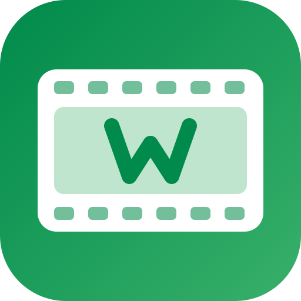

# WordNext Films app icon



The WordNext monogram (the mark of wordnext.tech) inside a film frame with sprocket holes, original
artwork by WordNext. It replaces the upstream FilmCraft icon (an owl) in this fork, and is the same
icon on the desktop apps and the browser version. Licence and trademark note:
[LICENSE.txt](LICENSE.txt).

**Tile:** `viewBox="0 0 512 512"`, a rounded square (`rx=112`) with a green gradient (`#008a4b` to
`#38b06a`), full bleed. White film strip, light-green picture area, green monogram.

## Files

| File | What it is |
|---|---|
| `filmcraft.svg` | the master vector; every PNG, `.ico` and `.icns` is rendered from it |
| `filmcraft-small.svg` | the same vector, for places that reference the light file, such as this README |
| `filmcraft-1024.png` | 1024 px render |
| `filmcraft-macos-512.png` | 512 px on Apple's grid (transparent margin); the runtime Dock icon on macOS |
| `filmcraft.icns` | macOS icon (128–1024 px) |
| `filmcraft.ico` | Windows icon (16–256 px), embedded in `filmcraft.exe` |
| `hicolor/<n>x<n>/apps/tech.wordnext.films.png` | Linux hicolor theme, 16–512 px |
| `hicolor/scalable/apps/tech.wordnext.films.svg` | Linux scalable icon |

The web build's favicon (`apps/filmcraft-web/web/favicon.png`) and the landing page icons
(`packaging/vercel/assemble.sh`) come from the same master.

## Regenerate

```sh
packaging/icons.sh        # needs resvg and python3; on macOS iconutil writes the .icns
cargo xtask assets        # checks the attribution sidecars
```
